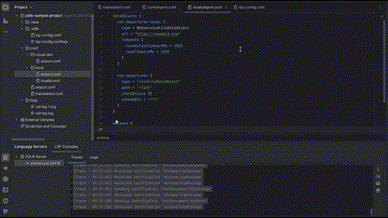
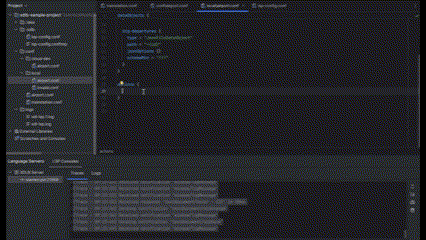
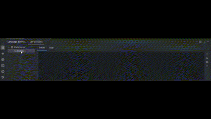
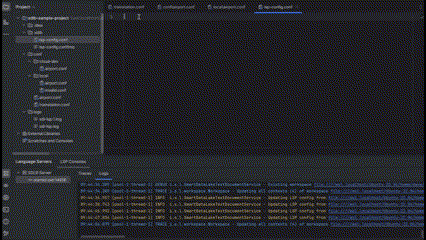
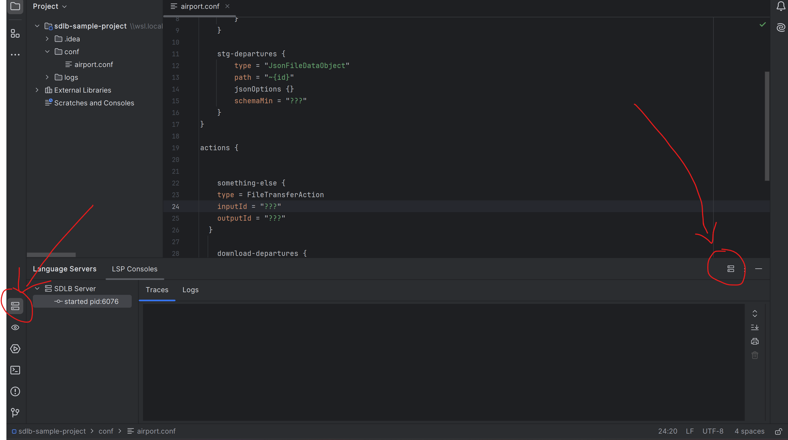
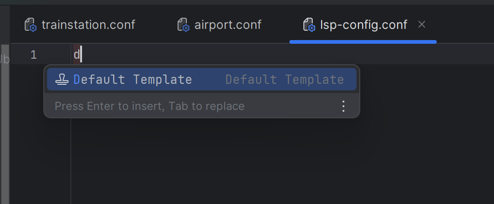
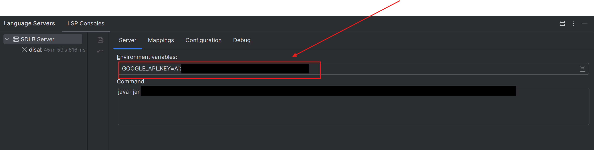

# Smart Data Lake Language Server Protocol (SDL LSP)

[LSP Implementation](https://microsoft.github.io/language-server-protocol/implementors/servers/) for the [Smart Data Lake Builder](https://smartdatalake.ch/) configuration files.

## Description

This LSP server currently provides:

* smart autocompletion suggestions
* Hovering description of objects, their attributes etc.
* Go to definition and find references of dataObjects and connections (`inputId`, `outputIds`, `connectionId`, ...), across files
* Outline of the dataObjects, actions and connections of a file

### Features

### 1. Basic Code Completion



### 2. ✨ AI-Augmented Code Completion ✨



### 3. Hovering Capability


### 4. Multi-File Context Awareness


### 5. Secure Streamlined Logs in the Client

*Works in IntelliJ, VSCode, Cursor, and more*


### 6. Generating Default Template Configs



## How it works

The server communicate with an LSP client, which can be a plugin in a code editor like Intellij, VSCode, Atom etc. or even a web interface.

Standard Input/Output channels are used to communicate with its client, using [JSON-RPC](https://www.jsonrpc.org/specification) protocol.

Usually the client has responsibility to start the server. They first communicate their capabilities and then the client make requests or provide notifications to the server.

## Getting Started

### Requirements

* Java 17 or newer
* IntelliJ (later also VSCode)

### Download

Download `sdl-lsp.jar` from the [latest release](https://github.com/smart-data-lake/sdl-lsp/releases/latest) (direct link: [sdl-lsp.jar](https://github.com/smart-data-lake/sdl-lsp/releases/latest/download/sdl-lsp.jar)) and store it in a directory of your choice. Each release also provides the same jar with its version in the file name.

**Hint:** Should you prefer building the project on your own, follow the instructions further below.

### Setting a basic LSP client in IntelliJ

* Download the generic LSP support for IntelliJ using [LSP4IJ](https://plugins.jetbrains.com/plugin/23257-lsp4ij).
* Look for the LSP4iJ icon on your IDE and click on the right and select `New Language Server`. See screnshot below: 
* provide the following parameters:
  * `Server > Name` -> `SDLB Server`
  * `Server > Command` -> `java -jar $PATH_TO_JAR` (see [Getting Started](#getting-started))
  * `Mappings > File name patters` -> click on `+` and then:
    * `File name patterns` -> `*.conf`
    * `Language Id` -> `hocon`
* Click on `ok`. The server should start.

### Setting the custom LSP client in VSCode

Work in progress, should be released soon. Stay tuned!

## LSP Server Configuration

The SDL LSP server behavior can be customized by creating a configuration file at `.sdlb/lsp-config.conf` in your project root. This file allows you to define the workspace and AI-assisted features.

**Hint:** You can generate a default template of the config file using the LSP itself. See screnshot below: 

### Workspace Configuration

The workspace determines which files are processed together by the LSP server. This matters for features like auto-completion that need context from multiple files, e.g. suggesting the ids of dataObjects defined in another file.

Like the `--config` option of the SDLB command line, `configPaths` lists the files and directories forming the workspace, comma-separated and relative to the project root. Directories are searched recursively for `.conf` files.

```hocon
configPaths = "conf,env/local.conf"
```

**Example structure:**

```plaintext
project/
├── .sdlb/
│   └── lsp-config.conf
├── conf/                # Part of the workspace, including all subfolders
│   ├── pipeline1/
│   │   └── extract.conf
│   └── common.conf
└── env/
    ├── local.conf       # Part of the workspace
    └── prod.conf        # Not in the workspace
```

In this example, `extract.conf`, `common.conf` and `local.conf` all see each other's content. Files outside `configPaths`, like `prod.conf`, can still be edited with completion and hovering, but are handled in isolation: they neither see nor affect the workspace files.

If `configPaths` is not set, all `.conf` files of the project are part of the workspace (hidden folders and `target` are skipped).

Changes of the LSP config file are applied when it is saved: the config files are reloaded, without losing the unsaved changes of opened files.

**Hint:** `configPaths` replaces the former `workspaceType` and `workspaceParameters` settings. A configuration using `workspaceType = ActiveWorkspace` is still understood: its `workspaceParameters` are used as `configPaths`.

### SDLB Schema

Completion and hovering are based on the JSON schema of SDLB configurations. The server bundles the schema of SDLB 2.5.0. To use the schema of your SDLB version, export it with SDLB and set its path, relative to the project root:

```hocon
schemaPath = "schema/sdl-schema.json"
```

If the file cannot be read, the bundled schema is used and a warning is logged.

### Logging

Logs are sent to the LSP client and written to `~/.sdl-lsp/logs/sdl-lsp.log`. The default level is `info`; set `logLevel = debug` in your `.sdlb/lsp-config.conf` for more details. The environment variables `SDL_LSP_LOG_LEVEL` and `SDL_LSP_LOG_DIR` change the level and the directory at startup; with `SDL_LSP_LOG_LEVEL=trace`, all JSON-RPC messages are logged as well.

### AI-Assisted Features

The SDL LSP server includes AI-assisted features to improve code completion and suggestions. It works with any endpoint implementing the OpenAI chat completions API (OpenAI, Gemini, Mistral, a local Ollama server, ...). By default, Gemini is used. To use these features:

1. Obtain an API key from your provider, e.g. a Google API key from [Google AI Studio](https://aistudio.google.com) for the default Gemini setup
2. Configure your LSP client to include the environment variable `AI_API_KEY` with your API key (`GOOGLE_API_KEY` is supported as well). See screnshot below: 
3. Optionally choose another provider or model, and customize the AI prompt in your `.sdlb/lsp-config.conf` file

#### Choosing the AI provider and model

```hocon
# Base URL of the OpenAI compatible API, default: https://generativelanguage.googleapis.com/v1beta/openai
aiBaseUrl = "https://api.openai.com/v1"
# Model name, default: gemini-3.5-flash-lite
aiModel = "gpt-5-mini"
```

For a local model, no API key is needed as soon as `aiBaseUrl` is set, e.g. with Ollama: `aiBaseUrl = "http://localhost:11434/v1"` and `aiModel = "qwen3:8b"`. Answers must arrive within 3 seconds, so prefer small and fast models.

#### Customizing AI Prompts

You can customize how the AI generates suggestions by modifying the prompt in your configuration file:

```hocon
tabStopsPrompt = """You're helping a user with code completion in an IDE.
The user's current file is about a Smart Data Lake Builder configuration, where the "dataObjects" block provides all the data sources
and the "actions" block usually defines a transformation from one or more data sources to another.
Extract a list of suggested tab stops default values.
Tab stops have the following format in the default insert text: ${number:default_value}.
Use the context text to suggest better default values.
Concerning the title of the object, try to infer the intention of the user.
For example, copying from the web to a json could be interpreted as a download action.
Output should be valid JSON with this schema:
[
  {
    "tab_stop_number": number,
    "new_value": string
  }
]

Default insert text:
$insertText

Suggested item is to be inserted in the following HOCON path:
$parentPath

Context text, HOCON format, the user's current file:
$contextText"""
```

This prompt helps the AI understand the context of your Smart Data Lake Builder configuration and provide more relevant suggestions for code completion.

The customized prompt is applied as soon as the LSP config file is saved.

## Build

### Build Requirements

To be able to build this project, you will need:

* maven
* java 17 or newer

### Building

* Clone the repo locally.
* run `mvn clean package`

After a successfull build, the `sdl-lsp-1.0-SNAPSHOT-jar-with-dependencies.jar` is located in `./target` directory.

### Releasing

Releases are published on GitHub by the `Release` workflow when a version tag is pushed:

```bash
git tag v1.2.0
git push origin v1.2.0
```

The workflow builds and tests the project with the version taken from the tag (`mvn package -Drevision=1.2.0`), then creates the GitHub release with generated release notes and the jar attached. Tags with a suffix, like `v1.2.0-rc1`, are published as pre-releases.

## Authors

[scalathe](https://github.com/dsalathe)

## License

This project is licensed under the GNU General Public License (GPL) version 3 - see the LICENSE.txt file for details
